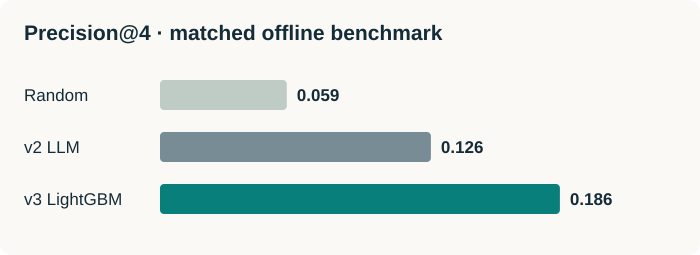

# From LLM ranking to a learned next-best-action system

An applied machine learning case study at Wealthsimple

**Noah · September 2026**

I built and evaluated NBA v3 to replace an existing prompt-based LLM ranker with a trainable LightGBM model. On the documented matched offline benchmark, Precision@4 increased from 0.126 to 0.186 (+47.6% relative). I then productionized the training pipeline and scoped a contextual-bandit decision layer and better behavioral reward signals.

## 01 · Why We Did It

### Make recommendations learn from outcomes.

Wealthsimple’s Next Best Action (NBA) system ranks eligible client actions for personalized surfaces, including four cards on the app’s “For You” home. Actions include funding an account, setting up recurring deposits, enabling security features, and adopting another product. The goal was to use those scarce slots to recommend actions a client was likely to complete, while retaining a separate model of business value.

#### Why replace v2?

The existing v2 LLM ranked actions from a prompt containing client context and business rules. Its task-specific behavior was controlled through prompting rather than fitted to our historical adoption labels. That made systematic retraining, score interpretation, and performance diagnosis difficult. Prompt-based inference also introduced a dependency we wanted to make more repeatable and easier to operate.

NBA v3 replaced that propensity-ranking component with supervised learning from observed client–action outcomes. LightGBM gave us a practical model to benchmark, retrain, and monitor on our own data. The project targeted recommendation quality and operational control; no inference-cost reduction or online deposit lift is claimed without measurements.

#### My contribution and the team boundary

My work covered model development, evaluation-metric selection, LLM benchmarking and statistical backtesting, analytical investigations, and refactoring the data and training pipeline into the team’s production stack. I also scoped the bandit layer and the gap between adoption propensity and action value. I reused the team’s foundation-model embeddings, action definitions, eligibility rules, and separate Action Value model.

**Result In One Sentence**

The offline benchmark improved Precision@4 by 0.060 (47.6% relative); the production training pipeline subsequently completed a full-population run. Customer-facing inference and the live learning loop remain separate rollout milestones.

**Client context → Eligible actions → v3 adoption scores → Value-aware ranking**

v3 replaces the LLM propensity head. Eligibility filtering and the separate Action Value head remain part of the system.

## 02 · What We Built

### A propensity model, evaluated for four slots.

The production-oriented v3 model is a LightGBM binary classifier used for ranking. The example grain is (client, anchor date, action). Its label is 1 when the client first completes that action in the post-anchor adoption window, and 0 otherwise. Actions already completed before the anchor or structurally ineligible at that time are excluded.

Each client’s context includes a point-in-time, 256-dimensional foundation-model embedding plus eight engineered attributes: three financial-capacity fields, age at signup, tier at registration and at the anchor, onboarding-linker status, and a tier/linker subsegment. An action identifier lets the model score different candidates for the same client.

#### Choose metrics to match the surface

| Metric | Use and tradeoff |
| --- | --- |
| Precision@4 | Primary for the current static four-card surface: completed actions in the top four ÷ 4. Treats slots equally; does not reward a better order within them. |
| NDCG@4 | Secondary ranking diagnostic; more suitable when a carousel or ordered feed gives earlier items greater exposure. Discounts lower ranks and normalizes against an ideal order. |
| Recall@4 | Coverage diagnostic: completed actions retrieved in the top four ÷ all completed actions. Useful alongside precision, but it does not directly measure use of the four available slots. |
| PR-AUC / ROC-AUC | Per-action discrimination and training diagnostics. PR-AUC is informative with rare positives; ROC-AUC can look strong despite low precision and does not measure top-four usefulness. |

These metrics answer different questions. A client who completes only one action can have Recall@4 = 1 but Precision@4 no higher than 0.25. A low-looking precision score is therefore not directly comparable to a higher recall or NDCG score.

#### Model choice and tradeoffs

LightGBM was a manageable starting point for nonlinear relationships in the embedding and tabular context. It supports feature diagnostics and repeatable scoring. The tradeoffs are a frozen policy between retrains, limited support for unseen action IDs, and the need to calibrate scores if a downstream consumer needs adoption probabilities.

#### Use analysis to choose the next features

A related onboarding analysis reused the team’s behavioral personas and shifted its anchor from registration to first funding, when behavioral context was more mature. It found different action patterns across personas and a 3.48× association between linking and 30-day Premium+ conversion among Core clients. These are hypotheses for targeted experiments and point-in-time feature engineering, not proven causal effects.

*Version distinction: an early prototype used multiclass prediction on completed actions. This case study’s system description follows the later binary client–anchor–action formulation. The earlier prototype’s metrics are not mixed into the headline benchmark.*

## 03 · How We Did It

### Reconstruct the past before judging the model.

#### Build labels and features at the right grain

Two raw dbt outputs provide client snapshots at monthly anchors and first-adoption events at the client–action grain. The training code derives features, expands each snapshot into candidate actions, applies per-anchor eligibility, and constructs labels. Keeping the wide client × action expansion out of dbt reduces the size of intermediate warehouse exports.

Feature information must precede the anchor. Embeddings use a recent pre-anchor snapshot; suitability and tier data use historical records. Current-state wealth and persona-cluster features were dropped when a reliable point-in-time source was unavailable. Eligibility captures are matched to their own anchor; missing captures are excluded rather than replaced by another date’s rules.

#### Train with severe imbalance

Positives were about 0.3–0.35% of eligible pairs. Extreme positive weighting had caused early stopping after one tree in a documented run. Removing that setting restored learning; later, training-only negative downsampling to 50 negatives per positive reduced the frame substantially. Validation and test retain the natural class distribution. Downsampling changes score calibration, so the output is treated as a ranking signal.

#### Validate model quality and statistical uncertainty

The benchmarking process uses a historical anchor, a post-anchor adoption window, and shared clients and candidate actions for v3, v2, and random ranking. Holdout outcomes are unseen during fitting. Metrics are examined both per request and per action; a single aggregate score can conceal losses on important actions.

The backtesting artifacts report 2,000 bootstrap resamples and 95% intervals for per-action comparisons. McNemar’s exact test was also explored for paired binary outcomes; it is not a direct test of a ratio such as per-action precision. A stronger promotion package would add paired client-level intervals for the aggregate Precision@4 difference and adjust for multiple action comparisons.

#### Validate the pipeline independently of the metric

Checks enforce grain uniqueness, pre-anchor features, mature label windows, completed-action exclusion, and eligibility coverage. Small smoke runs precede parity and scale runs. Shared transformations connect the notebook, training service, and Airflow orchestration; MLflow records the model, feature contract, and metrics.

*Window detail: offline benchmarking uses 30 days; the refactored monthly pipeline uses the following calendar month. Short overlapping backtest windows require care with dependent labels. Metric similarity across dates alone does not prove absence of leakage.*

## 04 · The Result

### Better use of the four recommendation slots.

The documented head-to-head benchmark compared LightGBM, the existing LLM, and random ranking on a shared evaluation cohort. Precision@4 is the headline because it matches the current static four-card surface. Values below are transcribed from the source benchmark figure.

| Metric | v3 LightGBM | v2 LLM | Random | v3 vs. v2 |
| --- | --- | --- | --- | --- |
| Precision@4 | 0.186 | 0.126 | 0.059 | +47.6% relative |
| NDCG@4 | 0.452 | 0.310 | 0.122 | +45.8% relative |
| Recall@4 | 0.596 | 0.382 | 0.178 | +56.0% relative |

The Precision@4 difference of 0.060 corresponds to 0.24 more historically completed actions recovered per four-slot request on average in the evaluated cohort. This is a retrieval improvement against observed outcomes, not an estimate of additional adoption caused by serving v3.

#### What the deeper analyses changed

Per-action precision favored the LLM on 17 actions and LightGBM on 14, with different recommendation volumes. A per-action “win” uses the users receiving that action as its denominator; it cannot be counted as an equal vote toward aggregate superiority. The backtest reported six nominally significant LightGBM precision wins, including passkey setup and credit-card autopay; no LLM win cleared the reported significance criterion.

A web-intent ablation moved NDCG@4 from 0.4856 to 0.4947 on another anchor, while PR-AUC fell from 0.0320 to 0.0301. Only 0.65% of candidate rows had nonzero intent. I kept intent out of the committed model rather than treating a small single-anchor change as established improvement.

**Production Training Validation — A Separate Run**

The July 24, 2026 training DAG completed end to end across 856,889 users, with held-out ROC-AUC 0.906. This validates the training path at scale; it is not the sample size or metric of the head-to-head benchmark.

*Scope: documented ranking reports condition on requests with at least one completed action. The source figure does not pin its exact evaluated N or aggregate confidence interval. These numbers should not be interpreted as all-client conversion rates or a statistically established aggregate causal lift.*

## 05 · Next Steps In Progress

### Learn from exploration, without amplifying bias.

A deterministic ranker can create a degenerate feedback loop: highly ranked actions receive more exposure, exposure influences adoption, and later training interprets those outcomes as stronger evidence for the same actions. Under-shown candidates get fewer chances to reveal their value. This is a risk of learning from policy-influenced outcomes, not proof that every recommendation concentration is a failure.

**Rank high → Show more → Observe adoption → Retrain on it**

Without exposure information and exploration, observed outcomes can reinforce the incumbent policy’s preferences.

#### Wrap the LightGBM scorer in a contextual bandit

The proposed FALCON/SquareCB-inspired decision layer reuses v3 as a reward scorer. Inverse-gap weighting converts score gaps into selection probabilities: mostly exploit strong candidates, but give near-misses a controlled chance. For four cards, sample a slate without replacement from eligible actions and record the conditional selection probability at each slot.

The first evaluation-only stage is documented as built and exercised end to end in staging. It compares greedy, exploratory, and uniform policies against held-out adoption labels and checks off-policy estimators using simulated logging. This tests the evaluation machinery under that replay setup; historical labels are not counterfactual rewards for different live exposures.

#### The next milestones

| Milestone | Why it matters |
| --- | --- |
| Finish batch inference | Persist a stable action encoding, retrain with the artifact, check exclusions and coverage, and bound memory through client batching. |
| Instrument one surface | Log request, context, eligible set, selected actions, policy version, surface, and selection probabilities; distinguish generated rankings from actual impressions. |
| Learn from mature rewards | Join impression records to matured adoption labels. Evaluate policies with overlap and effective-sample-size checks before promotion. |
| Run a guarded pilot | Keep a sticky control group, monitor recommendation concentration and coverage, and measure realized adoption and downstream value. |

The policy must handle delayed feedback and the action catalog explicitly. Positive exploration probabilities help identify policy value only where there is adequate support; very large weights make estimates unstable. An unseen action is not automatically supported by a scorer trained on a fixed encoding. New-arm onboarding needs its own eligibility and learning path.

*Status boundary: training is documented as live in production; customer-facing inference validation and live bandit learning remain pending in the reviewed workspace. Staging policy-value fields are not populated, so no numerical bandit improvement is claimed.*

## 06 · Current Data & Value Gaps

### “Likely to complete” is only one notion of “best.”

#### Define action, propensity, and value separately

An action is a catalog-defined step with eligibility rules and first-completion semantics. v3 predicts its completion in roughly the next month—not clicks, repeated engagement, or the incremental effect of a recommendation.

The separate Action Value model uses associated net-deposit growth: the later design note specifies deposits two months after an action minus deposits just before it. Other activity in that window can influence the target, so it is not isolated causal value.

The later note describes multiplying normalized propensity and value ranks; the earlier white paper describes averaging ranks. Reconcile the serving contract before changing rewards. Neither is calibrated propensity multiplied by causal monetary return.

#### What data is missing

| Signal | Current gap and consequence |
| --- | --- |
| Impressions + propensities | Reliable exposure and selection-probability logs are needed for learning from exploration and evaluating alternative policies. |
| Click-to-action mapping | Some content-card click events exist, but their mapping to action IDs is fragile. Generated rankings are not observed impressions. |
| Destination engagement | Completion is available; maintained action-linked dwell and funnel-depth coverage is missing. Existing flow analytics cover only some destinations. |
| Historical context | Some wealth and persona attributes lack point-in-time history. Using current state for historical decisions can leak information. |

#### My proposed improvement

My proposal is a behavioral value signal combining completion, funnel progress, abandonment, and destination engagement. Start with available completion and latency signals, test incremental usefulness offline, then scope action-to-screen mapping and broader telemetry. Keep financial value as a separate objective rather than treating deposits as every kind of client benefit.

Long dwell can mean confusion. Combine depth with completion and abandonment, normalize across flows, and consider security, trust, and retention. An online experiment must establish whether the richer reward improves experience and realized outcomes.

**Supplementary Workspace**

The companion workspace contains the model, evaluation, deployment, bandit, and reward-design notes. This case study separates results, system versions, and proposed work.

[Open the supplementary Notion workspace](https://app.notion.com/p/Next-Best-Action-NBA-v3-Ranking-System-Workspace-3b1d597724dd8008b43ddaf6059ae088?source=copy_link)
